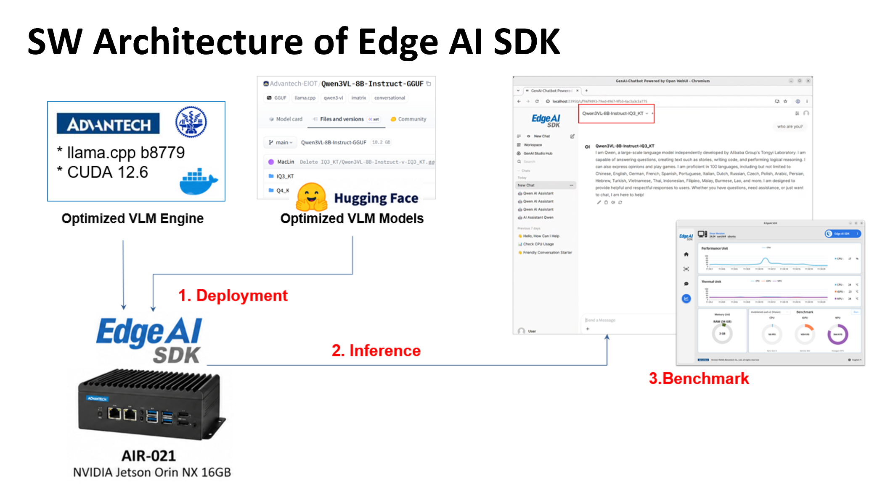
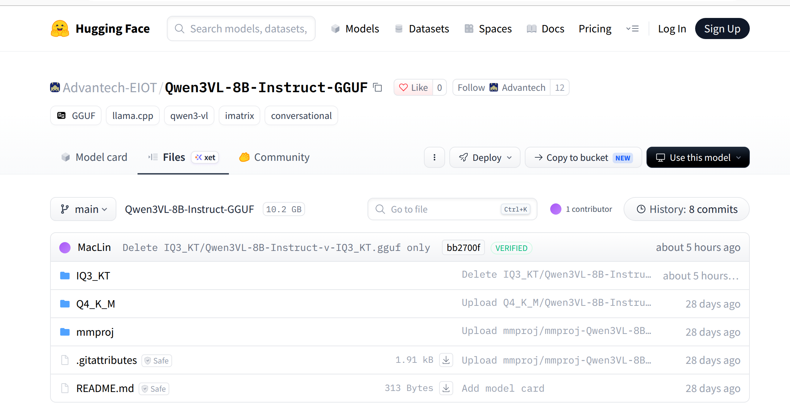
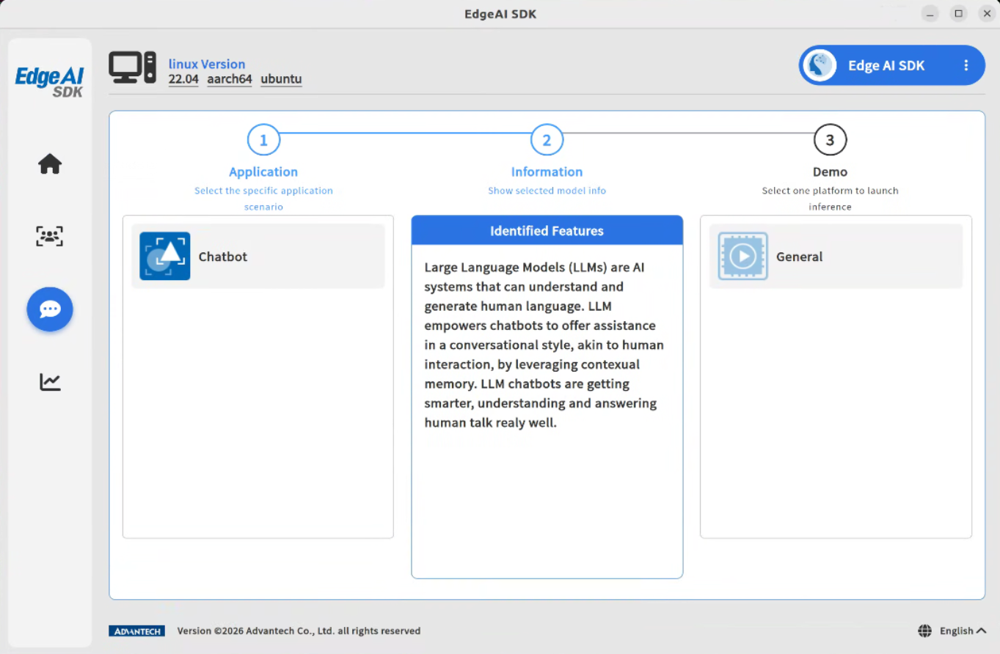
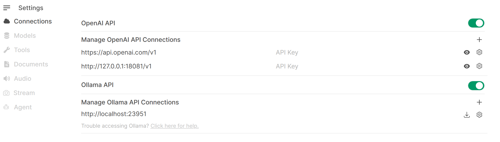
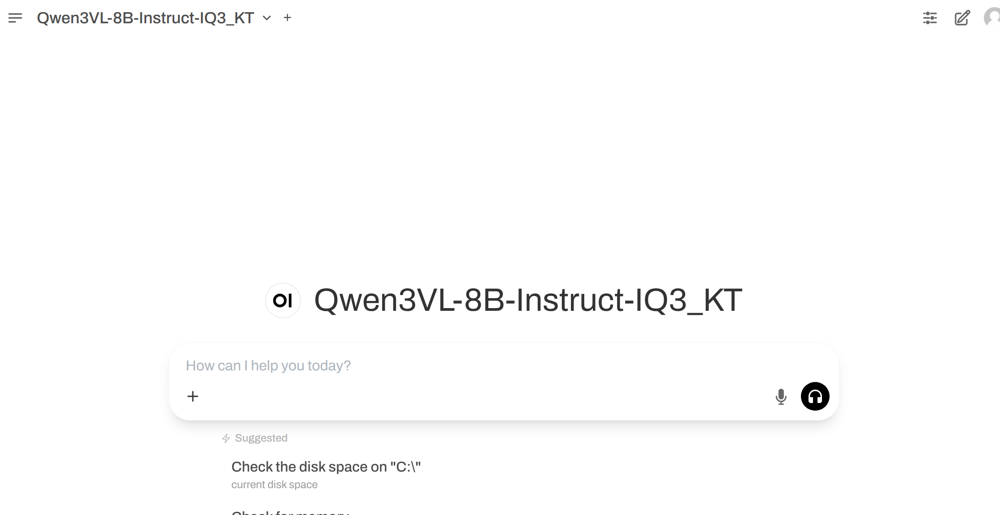
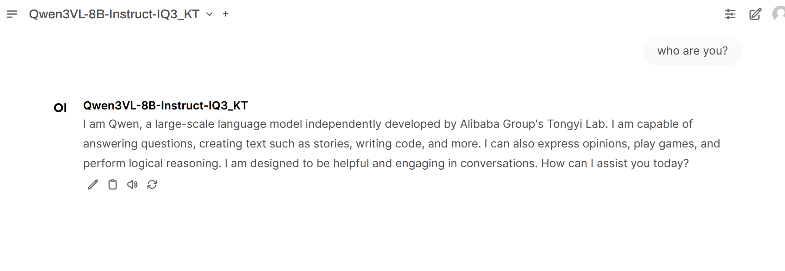
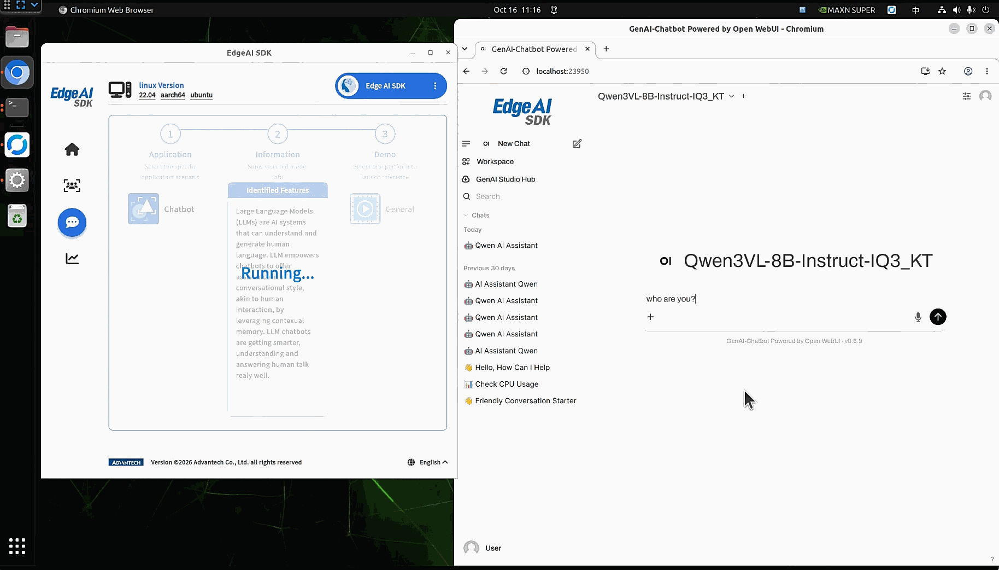
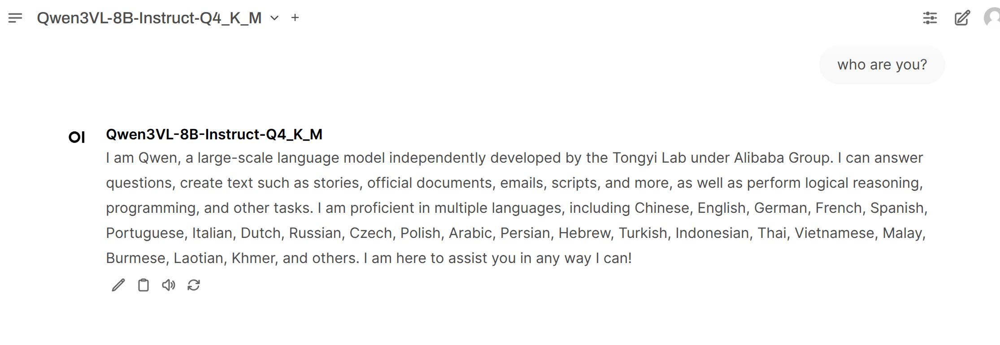
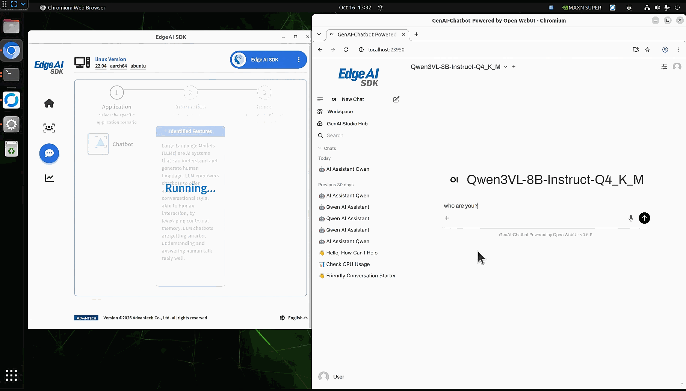

# How to deploy an IQ3_KT VLM model on AIR-021 NVIDIA Jetson Orin NX Platform.

Deploy Qwen3VL-8B-Instruct with IQ3_KT quantization on an NVIDIA Jetson using Docker Compose, expose a local OpenAI-compatible API, and chat through the existing Edge AI SDK Chatbot. This case also shows how to switch to Q4_K_M using the same runtime.



In the original demonstration, IQ3_KT used approximately **1.8 GB less system RAM** than Q4_K_M, leaving more memory available on a memory-constrained Jetson. See the [RAM usage comparison](#ram-usage-comparison) for the demonstration results.

- **Category**: Model Optimization — Edge LLM
- **Model source**: [Advantech-EIOT/Qwen3VL-8B-Instruct-GGUF](https://huggingface.co/Advantech-EIOT/Qwen3VL-8B-Instruct-GGUF)
- **Chatbot documentation**: [Edge AI SDK Chatbot user guide](https://docs.edge-ai-sdk.advantech.com/docs/Turtorial/Document/GenAI_Chatbot)

## Contents

- [Model and Runtime](#model-and-runtime)
- [Supported Platform](#supported-platform)
- [Prerequisites](#prerequisites)
- [Setup](#setup)
- [Development and Deployment](#development-and-deployment)
- [Result](#result)
  - [IQ3_KT Demonstration](#iq3_kt-demonstration)
  - [Q4_K_M Demonstration](#q4_k_m-demonstration)
  - [RAM Usage Comparison](#ram-usage-comparison)
- [Stop](#stop)
- [Deploy Across the AIR Series of Jetson Platforms](#deploy-across-the-air-series-of-jetson-platforms)
  - [Runtime Setup for JetPack 7](#runtime-setup-for-jetpack-7)
- [Troubleshooting](#troubleshooting)

## Model and Runtime

- **Model**: Qwen3VL-8B-Instruct, provided as IQ3_KT and Q4_K_M GGUF files.
- **Runtime**: `advigw/iq3kt-llama-server:jp6_b8779`, the project's custom JP6 llama.cpp runtime. An arbitrary upstream llama.cpp image is not a replacement for IQ3_KT support.
- **Deployment**: the included [docker-compose.yml](docker-compose.yml) defines one `llama-server` service. Change its model path and alias to switch between IQ3_KT and Q4_K_M.
- **Model storage**: GGUF files remain on the host and are mounted read-only. The runtime image does not contain the models.
- **Chat interface**: reuse the SDK's installed Chatbot. No second Open WebUI deployment is needed.

```text
Host GGUF model → Docker Compose / native llama-server → Local API → Edge AI SDK Chatbot
```

## Supported Platform

| Platform | Hardware | OS / Runtime Target | Edge AI SDK |
|---|---|---|---|
| AIR-021 | NVIDIA Jetson Orin NX, ARM64 (`aarch64`) | JetPack 6; L4T R36.4.3 / CUDA 12.6.11 | [Installation guide](https://docs.edge-ai-sdk.advantech.com/docs/Hardware/AI_System/Nvidia/Jetson%20Orin/AIR-021) |

Use a JetPack environment compatible with this JP6 runtime. The JP7 image is a separate build.

## Prerequisites

- Git, curl, Docker with NVIDIA Runtime, the Docker Compose plugin (`docker compose`), and a browser.
- The existing Edge AI SDK Chatbot, with normal login and administrator access to connection settings.
- Storage for both GGUF files and enough RAM for the loaded model, runtime buffers, and SDK. Model file size is not runtime RAM usage.
- Optionally, [jtop](https://github.com/rbonghi/jetson_stats) for observing system resources. It is not an API dependency.

## Setup

### Step 1: Download this project and prepare the directories

```bash
mkdir -p /home/ubuntu/Downloads
cd /home/ubuntu/Downloads
git clone https://github.com/ADVANTECH-Corp/edge-ai-hub.git
cd edge-ai-hub/AI_Case/Model-Optimization/IQ3_KT

mkdir -p /home/ubuntu/Downloads/iq3kt/models
```

### Step 2: Download and place the models

Open the [model repository on Hugging Face](https://huggingface.co/Advantech-EIOT/Qwen3VL-8B-Instruct-GGUF). Choose **Files and versions**, open the matching folder, select the main GGUF file, and use its download control.

| Format | Main GGUF File | Size on Disk |
|---|---|---|
| IQ3_KT | [Qwen3VL-8B-Instruct-IQ3_KT.gguf](https://huggingface.co/Advantech-EIOT/Qwen3VL-8B-Instruct-GGUF/blob/main/IQ3_KT/Qwen3VL-8B-Instruct-IQ3_KT.gguf) | 3.47 GB · 3,470,051,840 bytes |
| Q4_K_M | [Qwen3VL-8B-Instruct-Q4_K_M.gguf](https://huggingface.co/Advantech-EIOT/Qwen3VL-8B-Instruct-GGUF/blob/main/Q4_K_M/Qwen3VL-8B-Instruct-Q4_K_M.gguf) | 5.03 GB · 5,027,784,800 bytes |

Place both files directly under `/home/ubuntu/Downloads/iq3kt/models/`.



For a terminal download, use these direct file URLs:

```bash
curl --fail --location --continue-at - \
  --output /home/ubuntu/Downloads/iq3kt/models/Qwen3VL-8B-Instruct-IQ3_KT.gguf \
  https://huggingface.co/Advantech-EIOT/Qwen3VL-8B-Instruct-GGUF/resolve/main/IQ3_KT/Qwen3VL-8B-Instruct-IQ3_KT.gguf

curl --fail --location --continue-at - \
  --output /home/ubuntu/Downloads/iq3kt/models/Qwen3VL-8B-Instruct-Q4_K_M.gguf \
  https://huggingface.co/Advantech-EIOT/Qwen3VL-8B-Instruct-GGUF/resolve/main/Q4_K_M/Qwen3VL-8B-Instruct-Q4_K_M.gguf
```

`--location` follows redirects, `--continue-at -` resumes an incomplete file, and `--fail` stops on an HTTP error. If both model files have finished downloading, skip these download commands. The table links open the file pages; the `resolve/main` URLs download the files. Resume only if the remote file has not changed since the download began.

### Step 3: Review the Compose Configuration

Open [docker-compose.yml](docker-compose.yml). It defaults to the JP6 image and IQ3_KT model. The model path and alias in its `command` are:

```text
-m /models/Qwen3VL-8B-Instruct-IQ3_KT.gguf
--alias Qwen3VL-8B-Instruct-IQ3_KT
```

## Development and Deployment

### Step 1: Start IQ3_KT

```bash
cd /home/ubuntu/Downloads/edge-ai-hub/AI_Case/Model-Optimization/IQ3_KT
sudo docker compose up
```

**Expected:** IQ3_KT loads and the server log reports that it is ready to accept requests. If loading fails, resolve the error in the terminal before continuing.

Compose downloads the configured runtime image if it is not available locally, then starts the service. The GGUF model files must already be in the host model directory.

Keep this terminal open while using Chatbot in the browser. Compose displays the service logs here; **Ctrl+C stops the service**.

<details>
<summary>Runtime settings used by Compose</summary>

The service uses NVIDIA Runtime, host networking, and a read-only model mount. Native llama-server binds to `127.0.0.1:18081` with context 4096, batch 1024, ubatch 512, GPU layers 99, K/V cache `q4_0`, Flash Attention on, and one parallel slot. Set `--alias` to the selected model filename without `.gguf`.

</details>

### Step 2: Launch Edge AI SDK Chatbot

Open Edge AI SDK on the same Jetson. Click the **Chatbot** icon in the left sidebar, then click **General** in the **Demo** panel.



Wait several seconds for the SDK to load its default model and automatically open Chatbot in a browser. Once the page is ready, sign in normally.

**Chatbot URL:** http://localhost:23950/

### Step 3: Connect Edge AI SDK Chatbot

Go to **Admin Settings → Connections → OpenAI**; labels may differ slightly between SDK versions.

1. Enable the OpenAI API if disabled.
2. Reuse a matching connection, or add the exact base URL below.
3. For this local API, leave the API key blank and use the Default / standard-compatible provider.
4. Save, reload, and check that the connection persists.

```text
http://127.0.0.1:18081/v1
```



Keep existing connections and chat data. If connection settings are unavailable, ask your SDK administrator for access.

### Step 4: Select IQ3_KT and send one message

Select `Qwen3VL-8B-Instruct-IQ3_KT`, open a new conversation, and send the following once:

```text
who are you?
```



**Expected:** the Chatbot displays an answer and finishes generating. Wait for completion before switching models. Identify the model from the selector and the configured `--alias`, not from its self-description in the answer.

See the [IQ3_KT demonstration](#iq3_kt-demonstration) below.

### Step 5: Switch to Q4_K_M

Wait until IQ3_KT has finished responding, then press **Ctrl+C** in the Compose terminal and wait for the service to stop. Both models use the same service and API port; this configuration loads one model at a time.

Open `docker-compose.yml` and change only the model path and alias in `command` to:

```text
-m /models/Qwen3VL-8B-Instruct-Q4_K_M.gguf
--alias Qwen3VL-8B-Instruct-Q4_K_M
```

Leave the image, mount, and other runtime settings unchanged. Start the service again:

```bash
cd /home/ubuntu/Downloads/edge-ai-hub/AI_Case/Model-Optimization/IQ3_KT
sudo docker compose up
```

Compose recreates the service with the changed command. Wait for the server readiness message and keep the terminal open.

**Expected model ID:** `Qwen3VL-8B-Instruct-Q4_K_M`. The API base URL is unchanged.

Refresh the Chatbot model list, select Q4_K_M, and open a separate new conversation. Send `who are you?` once and wait for the complete visible response to finish. See the [Q4_K_M demonstration](#q4_k_m-demonstration) below.

To return to IQ3_KT, stop the service, restore the IQ3_KT model path and alias shown in Setup, and run `sudo docker compose up` again.

## Result

The screenshots, animations, and RAM readings below come from the original AIR-021 / JetPack 6 demonstration, where both models answered `who are you?` in Edge AI SDK Chatbot. They are not a new measurement of the Compose workflow.

### IQ3_KT Demonstration



<details open>
<summary>IQ3_KT — Chatbot Demo (show / hide animation)</summary>



</details>

### Q4_K_M Demonstration



<details open>
<summary>Q4_K_M — Chatbot Demo (show / hide animation)</summary>



</details>

### RAM Usage Comparison

The original inference demonstration shows system RAM usage of approximately **8.0 GB** with IQ3_KT and **9.8 GB** with Q4_K_M. In that demonstration, **IQ3_KT used about 1.8 GB less RAM than Q4_K_M**, leaving more memory available on a memory-constrained Jetson.

These are approximate system RAM readings shown in that demonstration, rather than model-only allocations or a peak/average benchmark for every workload.

## Stop

Wait for active requests to finish, then press **Ctrl+C** in the Compose terminal to stop the model API.

To stop and remove this case's model container from another terminal:

```bash
cd /home/ubuntu/Downloads/edge-ai-hub/AI_Case/Model-Optimization/IQ3_KT
sudo docker compose down
```

This affects only the `iq3kt` Compose project. It does not stop SDK Chatbot or delete host model files or chat data. To restart, run `sudo docker compose up` from this directory; it uses the model and image currently configured in `docker-compose.yml`.

## Deploy Across the AIR Series of Jetson Platforms

This walkthrough uses AIR-021 with JetPack 6. The IQ3_KT deployment approach can also extend to AIR-030 and AIR-075 with a compatible runtime, the required model assets, and sufficient memory for the intended workload.

| Platform | NVIDIA Jetson Family | Deployment Context |
|---|---|---|
| [AIR-021](https://www.advantech.com/zh-tw/products/932c8818-07cc-4917-89e9-7a678ddc029c/air-021/mod_8d927288-90ef-40d0-b192-f4e86b3d5c7c) | Jetson Orin NX / Nano | This walkthrough uses Orin NX with JetPack 6. |
| [AIR-030](https://www.advantech.com/zh-tw/products/932c8818-07cc-4917-89e9-7a678ddc029c/air-030/mod_a08e709e-09af-4124-bf1f-42d12c1c2fb0) | Jetson AGX Orin | Additional platform option; match the runtime to the installed JetPack version. |
| [AIR-075](https://www.advantech.com/zh-tw/products/932c8818-07cc-4917-89e9-7a678ddc029c/air-075/mod_8489cdc1-ab25-48e3-a493-085d8db1860f) | Jetson Thor | JetPack 7 platform; use the JP7 runtime image. |

The [RAM usage comparison](#ram-usage-comparison) applies to the original AIR-021 demonstration shown here. Select the model and runtime for the specific hardware and JetPack version.

### Runtime Setup for JetPack 7

For AIR-075 or other AIR-series platforms running a supported JetPack 7 release, confirm that the JP7 runtime image below supports the target Jetson hardware before proceeding.

Wait for active requests to finish and stop the current service before changing its image.

1. Open `docker-compose.yml` and replace its existing `image:` line with:

   ```yaml
   image: advigw/iq3kt-llama-server:jp7_b8779
   ```

2. Start the service from the case directory:

   ```bash
   sudo docker compose up
   ```

The same image setting applies to both model choices. Keep the model path and alias for the model you want to load, and leave the Compose terminal open while using Chatbot.

The deployment examples and RAM readings in this guide cover JetPack 6. For AIR-075 or other AIR-series platforms running JetPack 7, verify runtime compatibility, model support, and available memory on the target device before deployment.

## Troubleshooting

| Issue | Action |
|---|---|
| Model missing or download incomplete | Place the named GGUF under `/home/ubuntu/Downloads/iq3kt/models/` and finish the download before starting. Confirm that the `-m` path in `docker-compose.yml` matches the filename. |
| NVIDIA Runtime or image unavailable | Ensure Docker has NVIDIA Runtime configured. Check the image name, registry connectivity, and host compatibility; do not substitute a different runtime blindly. |
| Port 18081 occupied | Identify the listener before taking action. Stop it only if you recognize it and are authorized to do so; do not stop unknown services or perform global container or process cleanup. |
| Model API stopped after Ctrl+C | `docker compose up` runs in the foreground. Keep that terminal open during Chatbot use; run `sudo docker compose up` again to restart. |
| API not ready or model load failed | Check available memory and the service logs before continuing to Chatbot. |
| Chatbot missing the model or showing the old name | Confirm that the service has loaded the selected model, the connection URL includes `/v1`, and `--alias` matches the intended model ID. Reload the Chatbot model list and select the current model. |
| Response incomplete | Wait for generation to finish. If the answer is cut off or an error appears, check the output limit and service logs. |

From the case directory, inspect the service logs with:

```bash
sudo docker compose logs llama-server
```
